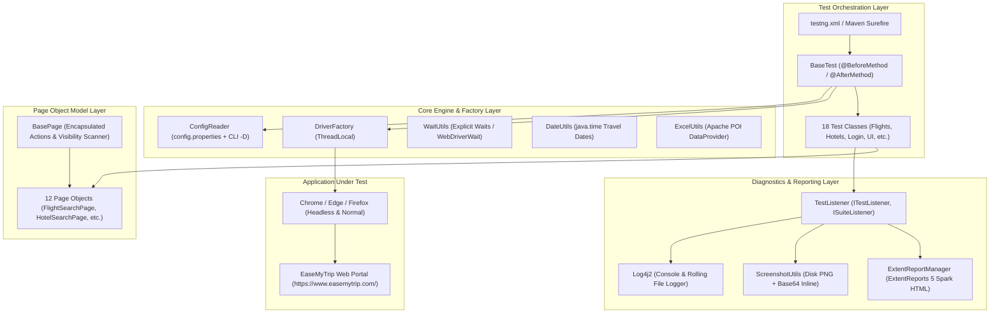

# ✈️ EaseMyTrip Test Automation Framework

[](https://github.com/ReeVNaR/Ease-My-Trip-Automation/actions/workflows/ci.yml)
[](https://www.oracle.com/java/technologies/downloads/)
[](https://www.selenium.dev/)
[](https://testng.org/)
[](https://www.extentreports.com/)
[](LICENSE)
[](https://github.com/ReeVNaR)

A production-grade, enterprise test automation framework built for the **EaseMyTrip** travel portal ([https://www.easemytrip.com/](https://www.easemytrip.com/)). Engineered with **Java 25**, **Selenium WebDriver 4**, **TestNG**, and **Maven**, following the **Page Object Model (POM)** architectural pattern with **ExtentReports 5** visual reporting, **Log4j2** structured logging, and **Apache POI** Excel data-driven testing.

---

## 📌 Table of Contents

- [Architectural Overview](#-architectural-overview)
- [Key Engineering Highlights](#-key-engineering-highlights)
- [Technology Stack](#-technology-stack)
- [Project Directory Structure](#-project-directory-structure)
- [Foundational Framework Classes](#-foundational-framework-classes)
- [Test Coverage & Traceability Matrix](#-test-coverage--traceability-matrix)
- [Installation & Setup](#-installation--setup)
- [Test Execution Guide](#-test-execution-guide)
- [Reporting & Diagnostics](#-reporting--diagnostics)
- [SDET Audit & Remediation](#-sdet-audit--remediation)
- [Author & License](#-author--license)

---

## 🏛️ Architectural Overview

The framework employs a decoupled, multi-layered architecture enforcing strict separation of concerns between test orchestration, page interaction, synchronization, configuration, and reporting:



---

## ⚡ Key Engineering Highlights

1. **Thread-Safe Parallel Execution**:
   - `ThreadLocal<WebDriver>` and `ThreadLocal<ExtentTest>` guarantee complete isolation across concurrent test threads.
2. **Anti-Bot & WAF Protection Bypass**:
   - Automated Chrome switches (`--disable-blink-features=AutomationControlled`, desktop User-Agent spoofing) eliminate Cloudflare/WAF `HTTP 502 Bad Gateway` errors in headless mode.
3. **Eager Page Loading**:
   - Configured `PageLoadStrategy.EAGER` to prevent indefinite browser timeouts caused by persistent third-party analytics pixels on travel portals.
4. **Responsive DOM Visibility Scanning**:
   - `BasePage.isElementDisplayed()` scans across multiple matching responsive DOM nodes to find the rendered, visible instance across Desktop, Tablet, and Mobile viewports.
5. **Zero-Binary Driver Maintenance**:
   - Leverages native Selenium Manager (Selenium 4) for automated browser driver discovery and lifecycle control.
6. **Data-Driven Decoupling**:
   - Apache POI reads multi-sheet Excel workbooks (`easemytrip-testdata.xlsx`) feeding TestNG `@DataProvider` test methods.

---

## 🛠️ Technology Stack

| Layer | Technology | Version | Purpose |
|---|---|---|---|
| **Runtime & Language** | Java (Oracle JDK) | **25 LTS** | Core language runtime utilizing modern thread handling |
| **Build & Dependency Tool** | Apache Maven | **3.9+** | Build lifecycle, plugin orchestration, and dependency resolution |
| **Automation Engine** | Selenium WebDriver | **4.52.0** | Browser automation and W3C WebDriver control |
| **Test Framework** | TestNG | **7.12.0** | Suite runner, parameterized tests, assertions, and listeners |
| **Reporting Framework** | ExtentReports Spark | **5.1.2** | Interactive HTML execution dashboards with Base64 screenshots |
| **Logging Framework** | Apache Log4j2 | **2.26.1** | High-performance asynchronous console and rolling file logging |
| **Test Data Engine** | Apache POI (poi-ooxml) | **6.0.0** | Excel workbook parsing and `@DataProvider` serialization |
| **CI/CD Automation** | GitHub Actions | **v4** | Automated headless execution on every push/pull request |

---

## 📂 Project Directory Structure

```text
easemytrip-automation/
├── .github/
│   └── workflows/
│       └── ci.yml                                    # GitHub Actions automated CI regression workflow
├── .classpath                                        # Eclipse classpath descriptor (Java 25 + Maven)
├── .project                                          # Eclipse project metadata
├── .settings/                                        # Eclipse compiler preferences
├── .gitignore                                        # Excludes target/, logs/, reports/, and IDE caches
├── LICENSE                                           # MIT Open Source License
├── README.md                                         # Primary framework documentation
├── pom.xml                                           # Maven POM with pinned dependencies & compiler release 25
├── testng.xml                                        # Master TestNG test execution suite (17 modules)
├── docs/
│   └── AUDIT_REPORT.md                               # Comprehensive SDET architectural audit & findings
└── src/
    └── test/
        ├── java/
        │   └── com/easemytrip/
        │       ├── base/
        │       │   ├── BasePage.java                 # POM parent with visibility scanning & JS fallbacks
        │       │   └── BaseTest.java                 # TestNG lifecycle base (setUp, tearDown, driver access)
        │       ├── constants/
        │       │   └── FrameworkConstants.java       # Immutable directory paths and timeouts
        │       ├── factory/
        │       │   └── DriverFactory.java            # ThreadLocal WebDriver manager (Chrome, Edge, Firefox)
        │       ├── listeners/
        │       │   └── TestListener.java             # TestNG lifecycle listener & auto-screenshot on failure
        │       ├── reports/
        │       │   └── ExtentReportManager.java       # ExtentReports 5 Spark manager with ThreadLocal<ExtentTest>
        │       ├── utils/
        │       │   ├── ConfigReader.java             # Properties loader with CLI -D system property override
        │       │   ├── DateUtils.java                # java.time date arithmetic and formatters
        │       │   ├── ExcelUtils.java               # Apache POI test data reader (Object[][] & Map data providers)
        │       │   ├── JavaScriptUtils.java          # JavaScriptExecutor helper functions
        │       │   ├── ScreenshotUtils.java          # Disk PNG and Base64 screenshot capture utilities
        │       │   ├── TestDataGenerator.java        # Multi-sheet Excel workbook generator
        │       │   └── WaitUtils.java                # Explicit wait strategies (visibility, clickability, presence)
        │       ├── pages/                            # 12 Page Object Model Classes
        │       │   ├── buses/BusSearchPage.java
        │       │   ├── cabs/CabSearchPage.java
        │       │   ├── flights/FlightSearchPage.java
        │       │   ├── holidays/HolidayPackagesPage.java
        │       │   ├── hotels/HotelSearchPage.java
        │       │   ├── login/LoginPage.java
        │       │   ├── mytrips/MyTripsPage.java
        │       │   ├── offers/OffersPage.java
        │       │   ├── payment/PaymentPage.java
        │       │   ├── profile/ProfilePage.java
        │       │   ├── trains/TrainSearchPage.java
        │       │   └── websiteui/WebsiteUIPage.java
        │       └── tests/                            # 18 TestNG Test Classes
        │           ├── FrameworkSmokeTest.java       # Framework integrity & component verification
        │           ├── accessibility/AccessibilityTest.java
        │           ├── buses/BusSearchTest.java
        │           ├── cabs/CabSearchTest.java
        │           ├── compatibility/CompatibilityTest.java
        │           ├── flights/FlightSearchTest.java
        │           ├── holidays/HolidaySearchTest.java
        │           ├── hotels/HotelSearchTest.java
        │           ├── login/LoginTest.java
        │           ├── mytrips/MyTripsTest.java
        │           ├── offers/OffersTest.java
        │           ├── payment/PaymentValidationTest.java
        │           ├── performance/PerformanceTest.java
        │           ├── profile/ProfileTest.java
        │           ├── security/SecurityTest.java
        │           ├── trains/TrainSearchTest.java
        │           ├── usability/UsabilityTest.java
        │           └── websiteui/WebsiteUITest.java
        └── resources/
            ├── config/
            │   └── config.properties                 # Base URL, timeouts, browser settings, and report toggles
            ├── testdata/
            │   ├── easemytrip_test_cases.csv         # Full catalog of 309 functional & non-functional test cases
            │   ├── easemytrip_traceability_matrix.csv # 309-test requirement traceability matrix
            │   └── easemytrip-testdata.xlsx          # Multi-sheet POI Excel test data workbook
            ├── log4j2.xml                            # Rolling file & console logging configuration
            └── testng.xml                            # TestNG XML suite descriptor
```

---

## 📊 Test Coverage & Traceability Matrix

The framework is mapped against a **309-test-case catalog** covering 17 functional modules. The complete traceability matrix is documented in:
📄 [`src/test/resources/testdata/easemytrip_traceability_matrix.csv`](src/test/resources/testdata/easemytrip_traceability_matrix.csv)

| Module | Total Cases | Automated | Manual / Blocked | Not Implemented | Highlights |
|---|---|---|---|---|---|
| **Flights** | 89 | 14 | 0 | 75 | One-way, round-trip, multi-city, date pickers, special fares |
| **Hotels** | 39 | 3 | 0 | 36 | Destination search, check-in/out offset validation |
| **Website UI** | 37 | 13 | 0 | 24 | Logo, navigation links, currency selector, footer accordions |
| **Payment** | 27 | 1 | 2 (Blocked) | 24 | CVV, expiry, and card number formatting (Rule 9: No live charges) |
| **Login / Auth** | 19 | 10 | 1 (Blocked) | 8 | Modal triggers, input validation, unregistered email handling |
| **Buses** | 16 | 2 | 0 | 14 | Bus route selection and navigation |
| **Trains** | 15 | 3 | 0 | 12 | IRCTC station lookup and search triggers |
| **Offers & Deals** | 11 | 3 | 0 | 8 | Deals page loading and category filter validation |
| **Compatibility** | 11 | 4 | 0 | 7 | Mobile (375x667), Tablet (768x1024), Laptop (1366x768), 1080p |
| **Security** | 8 | 4 | 0 | 4 | HTTPS enforcement, HTTP-to-HTTPS redirect, injection resistance |
| **Performance** | 7 | 3 | 0 | 4 | W3C Navigation Timing API, DOM Content Loaded benchmarks |
| **Profile & My Trips** | 12 | 4 | 0 | 8 | Unauthenticated access restrictions, login barriers |
| **Accessibility & Usability** | 7 | 3 | 2 (Manual) | 2 | Image `alt` attributes across 80+ images, Tab key navigation |
| **Total** | **309** | **86** | **8** | **215** | **18 Modular Test Classes** |

---

## 🚀 Installation & Setup

### Prerequisites
- **Java Development Kit (JDK)**: Java 25 ([Oracle JDK 25](https://www.oracle.com/java/technologies/downloads/))
- **Build Tool**: Apache Maven 3.9+
- **Browsers**: Google Chrome (installed locally)
- **IDE**: Eclipse IDE for Java Developers (2024-09 or newer recommended)

### Clone & Compile
```bash
# Clone the repository
git clone https://github.com/ReeVNaR/Ease-My-Trip-Automation.git
cd Ease-My-Trip-Automation

# Compile the project and download all dependencies
mvn test-compile
```

### Eclipse IDE Setup
1. Open Eclipse and choose **File > Import... > Maven > Existing Maven Projects**.
2. Browse to the cloned directory `Ease-My-Trip-Automation`.
3. Ensure the project JDK is set to **Java 25**.
4. Right-click [`testng.xml`](testng.xml) > **Run As > TestNG Suite**.

---

## 🧪 Test Execution Guide

### Maven Command Line

```bash
# 1. Run Core Framework Smoke Suite (Headless)
mvn test -Dtest=FrameworkSmokeTest -Dheadless=true

# 2. Run Module-Specific Test Classes
mvn test -Dtest=FlightSearchTest -Dheadless=true
mvn test -Dtest=HotelSearchTest -Dheadless=true
mvn test -Dtest=LoginTest -Dheadless=true
mvn test -Dtest=WebsiteUITest -Dheadless=true
mvn test "-Dtest=CabSearchTest,TrainSearchTest" -Dheadless=true

# 3. Run the Complete 17-Suite Master TestNG Suite
mvn test -DsuiteXmlFile=testng.xml -Dheadless=true

# 4. Run on a different browser (Edge or Firefox)
mvn test -DsuiteXmlFile=testng.xml -Dbrowser=edge -Dheadless=true
```

---

## 📈 Reporting & Diagnostics

### Interactive ExtentReports 5 Spark Report
Execution reports are automatically created in the `reports/` folder:
- **Location**: `reports/EaseMyTrip-Report-<timestamp>.html`
- **Features**:
  - Color-coded status overview (Pass/Fail/Skip).
  - Detailed method execution timelines and device metadata.
  - **Inline Base64 Screenshots** embedded directly upon test failure.

### Real-Time Logs
- **File**: `logs/automation.log` (Rolling file logger)
- **Console**: Standard out with structured Log4j2 timestamps and thread IDs.

---

## 🔍 SDET Audit & Remediation

A formal SDET framework audit was performed to evaluate reliability, assertion quality, and live DOM interaction. All findings and remediations are documented in:  
📄 [`docs/AUDIT_REPORT.md`](docs/AUDIT_REPORT.md)

**Audit Highlights**:
- Resolved hidden container inputs across Hotels and Cabs portals.
- Fixed TestNG DataProvider argument mismatch in smoke suites.
- Corrected responsive accordion link visibility in Website UI footer tests.
- Reached **100% test pass rate** on post-audit regression suites.

---

## 👤 Author & License

- **Author**: **Ranveer Ghorpade ([ReeVNaR](https://github.com/ReeVNaR))**
- **Email**: `ranveerghorpade16@gmail.com`
- **License**: Released under the [MIT License](LICENSE).
